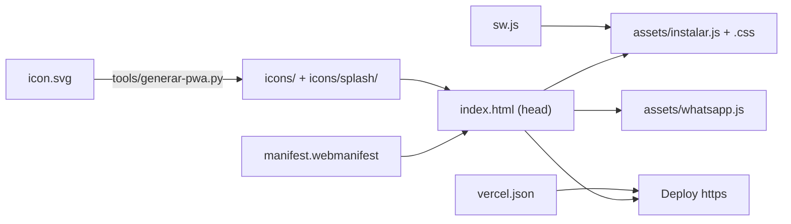

# Convertir otra página en PWA (web que se instala como app)

Receta para repetir en cualquier página lo que se hizo en
`templates/gimnasio/` (FORJA Gym, octubre de 2026). Sirve para otra demo de
este repo o para un sitio estático aparte. Guía visual con capturas reales
de iPhone: <https://claude.ai/artifact/JyNjQtxkzcAGbrFNcGJWDt> (privada,
se comparte desde su menú Share).

Resultado: ícono en la pantalla de inicio, pantalla de arranque con la marca,
abre a pantalla completa, funciona sin conexión, un aviso discreto que explica
cómo instalarla según el teléfono, y los botones de WhatsApp que abren la app.



## Antes de empezar: ¿vale la pena?

Solo si la persona va a abrir la página seguido: horarios, reservas, carta
con pedidos, agenda, un QR de ingreso. Una landing de un solo servicio nadie
la instala; ahí alcanza con que los botones de WhatsApp abran la app (paso 7).

## Qué se copia y qué se crea

| Archivo | De dónde | ¿Se edita? |
|---|---|---|
| `assets/instalar.js` | Copiar tal cual | No |
| `assets/instalar.css` | Copiar tal cual | No (se tiñe con variables) |
| `assets/whatsapp.js` | Copiar tal cual | No |
| `tools/generar-pwa.py` | Copiar tal cual | No |
| `<pagina>/icons/icon.svg` | Crear: ícono cuadrado | Sí |
| `<pagina>/icons/splash/marca.svg` | Crear (opcional): logo + nombre | Sí |
| `<pagina>/manifest.webmanifest` | Copiar el del gym | Nombre, colores, descripción |
| `<pagina>/sw.js` | Copiar el del gym | `CACHE` y la lista `PRECACHE` |
| `vercel.json` (raíz) | Copiar el del repo | No |

Las rutas de este documento asumen la estructura del repo
(`templates/<pagina>/` y `assets/` dos carpetas arriba, `../../assets/`). En
otro sitio, ajusta esas rutas.

## Paso a paso

### 1. El ícono

`icons/icon.svg`, cuadrado, con el fondo hasta el borde y el logo dentro del
círculo central del 80 % (Android recorta el ícono "maskable" en círculo o en
gota). Dibuja el logo con formas, no con texto: un `<text>` depende de que la
fuente exista en la máquina que exporta. Ejemplo: `templates/gimnasio/icons/icon.svg`.

Para el splash, opcional, `icons/splash/marca.svg`: logo y nombre sin fondo
(el fondo lo pone el script). Ejemplo: `templates/gimnasio/icons/splash/marca.svg`.

### 2. Generar íconos y splash

```bash
brew install librsvg   # una sola vez, trae rsvg-convert
python3 tools/generar-pwa.py --svg templates/<pagina>/icons/icon.svg \
    --marca templates/<pagina>/icons/splash/marca.svg \
    --bg "#000000" --out templates/<pagina>
```

Crea `icon-192.png`, `icon-512.png`, `icon-maskable-512.png`,
`apple-touch-icon.png` (180, sin transparencia) y 12 `splash-WxH.png`
(iPhone SE a Pro Max y iPad). Al final imprime las líneas del `<head>` y el
bloque `icons` del manifest: cópialas en los pasos 3 y 4.

### 3. El manifest

`manifest.webmanifest` junto al `index.html`. Cambia `name`, `short_name`
(lo que se lee bajo el ícono: 12 caracteres como mucho), `description`,
`background_color` y `theme_color`. Deja `id`, `start_url` y `scope` en
`"./"`: relativos, funcionan igual en local y en Vercel, y cada página es
una app distinta.

### 4. El `<head>`

```html
<meta name="theme-color" content="#000000">
<!-- Sin la barra final las rutas ./ fallan; vercel.json ya redirige,
     esto cubre cualquier otro hosting -->
<script>
  if (!/\/$|\.html$/.test(location.pathname)) {
    location.replace(location.pathname + "/" + location.search + location.hash);
  }
</script>
<link rel="manifest" href="./manifest.webmanifest">
<link rel="apple-touch-icon" href="./icons/apple-touch-icon.png">
<meta name="apple-mobile-web-app-title" content="NOMBRE">
<meta name="apple-mobile-web-app-capable" content="yes">
<meta name="mobile-web-app-capable" content="yes">
<meta name="apple-mobile-web-app-status-bar-style" content="black">
<!-- aquí las 12 líneas apple-touch-startup-image que imprimió el script -->
<link rel="stylesheet" href="../../assets/instalar.css">
```

`apple-mobile-web-app-title` es el nombre que usa el aviso de instalación;
`apple-touch-icon`, el ícono del aviso.

### 5. El service worker

Copia `templates/gimnasio/sw.js` y edita:

- `CACHE`: un prefijo propio (`"mipagina-v1"`). **Súbele el número cada vez
  que publiques cambios de CSS, JS o fotos**, si no, los teléfonos siguen con
  la copia vieja.
- `PRECACHE`: los archivos para abrir sin conexión, con la URL exacta que
  pide el HTML (si el CSS va con `?v=…`, igual aquí). Si un archivo de la
  lista no existe, el service worker no se instala.
- El `startsWith("forja-")` del evento `activate`: cámbialo por tu prefijo.

### 6. El aviso de instalación

Antes de `</body>`:

```html
<script src="../../assets/instalar.js" data-sw="./sw.js" defer></script>
```

Registra el service worker (no hace falta otro script) y muestra el aviso.
Tíñelo con los colores de la página en su `theme.css`:

```css
.instalar {
  --instalar-bg: #191919;
  --instalar-fg: #ffffff;
  --instalar-muted: #a3a3a3;
  --instalar-accent: #d8ff33;     /* botón Instalar */
  --instalar-accent-fg: #000000;
  --instalar-radius: 24px;
  font-family: var(--font-body);
}
```

En iPhone no usa esos colores: imita iOS (fuente del sistema, material
translúcido, azul del sistema, claro/oscuro del teléfono).

Un enlace con `data-instalar-abrir` lo abre a mano (el gym lo tiene en el
pie: «Instalar la app»).

Cómo se comporta:

| Dónde se abre | Qué ve |
|---|---|
| Android / PC con Chrome, Edge, Samsung | Barra con botón **Instalar** (diálogo del sistema) |
| iPhone / iPad | Barra estilo notificación + «Cómo» → hoja: Compartir → «Agregar a Inicio» → «Agregar» |
| Instagram, Facebook, TikTok | «Ábrela en Safari/Chrome» + Copiar enlace (desde ahí no se puede instalar) |
| Ya instalada o dentro de un iframe | Nada |

- Aparece a la mitad de la página o a los 45 s, nunca al entrar, una vez por
  visita.
- La ✕ la oculta 30 días en ese navegador.
- `?instalar=android|ios|inapp|instalada` en la URL fuerza un caso al
  instante (para mostrárselo a un cliente o probar, aunque se haya tocado ✕).

### 7. WhatsApp abre la app

Antes de `</body>`:

```html
<script src="../../assets/whatsapp.js" defer></script>
```

Los enlaces siguen escritos como `https://wa.me/<número>?text=…`. En el
teléfono, al tocarlos, abren la app (Android: `intent://`, iPhone:
`whatsapp://`). Si a los 1,5 s no abrió nada (no está instalada), van a
`wa.me` como siempre. En computadora no cambia nada. Sirve aunque la página
no sea PWA.

### 8. El splash en modo app (opcional, recomendado)

Las imágenes del paso 2 cubren la carga. Para que el paso de la imagen a la
página no se note, en `theme.css`:

```css
@media (display-mode: standalone) {
  body::before {
    content: "";
    position: fixed;
    inset: 0;
    z-index: 1000;
    background: #000 url("./icons/splash/marca.svg") center / 84px auto no-repeat;
    pointer-events: none;
    animation: splash-out 0.45s ease 0.7s forwards;
  }
}
@keyframes splash-out { to { opacity: 0; visibility: hidden; } }
```

El ancho (`84px`) tiene que coincidir con el `--ancho` del script (22 % de un
iPhone de 390 pt ≈ 86 px).

### 9. Vercel

Copia `vercel.json` a la raíz del repo si no existe:

- `"trailingSlash": true` — **no es opcional**. Ver el problema 1 abajo.
- `Cache-Control: no-cache` para `sw.js`: las actualizaciones llegan apenas
  se publica.

### 10. Probar

| Qué | Cómo |
|---|---|
| Manifest y SW | Chrome → Inspeccionar → **Application**: manifest sin errores, service worker «activated» |
| Instalable | En Chrome aparece el ícono Instalar en la barra de direcciones |
| Sin conexión | Apagar el servidor local y recargar: si abre, sale de la caché |
| Cada caso del aviso | `?instalar=android`, `ios`, `inapp`, `instalada` |
| iPhone real | Simulador de Xcode → Safari → Compartir → Agregar a Inicio |

Servidor local (el navegador integrado de Claude Code no sirve, ver abajo):

```bash
python3 -m http.server 8790 --bind 127.0.0.1
```

Pruebas automáticas en Chrome real con `agent-browser`:

```bash
agent-browser set device "iPhone 14"
agent-browser open "http://127.0.0.1:8790/templates/<pagina>/?instalar=ios"
agent-browser screenshot aviso.png
```

## Actualizar sin reinstalar

| Cambias… | Qué hacer | Cuándo se ve |
|---|---|---|
| Textos o HTML | Publicar | La próxima vez que se abre |
| CSS, JS o fotos | Publicar y subir `CACHE` en `sw.js` | Al abrir: `instalar.js` recarga sola la página (~2 s) |
| Ícono, nombre o splash | Publicar | Android solo, en días. iPhone: borrar el ícono y agregarlo de nuevo |

## Problemas que ya pasaron (no repetirlos)

1. **Sin fotos ni colores en el teléfono.** La URL quedó sin la barra final
   (`/templates/gimnasio`) y todas las rutas `./` apuntaban a `/templates/`:
   no cargaban `theme.css` ni `images/`, pero sí `../../assets/`. Solución:
   `trailingSlash` en `vercel.json` y el script del paso 4.
2. **El navegador integrado de Claude Code no permite service workers**
   («unknown error fetching the script»). Probar con `agent-browser` o con el
   Chrome del sistema.
3. **El preview de Vercel pide login** (Deployment Protection). Para que otra
   persona lo abra: dashboard → deployment → **Share**.
4. **Nombres de los menús de iOS**: es «Agregar a Inicio», no «Agregar a
   pantalla de inicio» (visto en un iPhone con iOS 18 en español).
5. **El aviso no debe ser una tarjeta grande.** La primera versión tapaba
   contenido y se sintió invasiva; quedó en una barra de una línea.
6. **iOS guarda el splash al instalar.** Para ver un splash nuevo, borra el
   ícono de la pantalla de inicio y vuelve a agregarlo.
7. **El simulador no tiene WhatsApp**: siempre cae a la página de wa.me. El
   salto a la app solo se ve en un teléfono con WhatsApp instalado.
8. **Caché vieja**: si un cambio no aparece en la app instalada, falta subir
   `CACHE` en `sw.js`.

## Referencia: la demo del gimnasio

Commits en `design/gimnasio-refresh`: `17bec1e` (PWA base), `abd1652`
(trailing slash, barra discreta), `6ede735` (hoja iOS, splash, menú),
`c715514` (WhatsApp). Documentación completa en la bóveda David:
`Guías/PWA/` (00 a 08: instalación, implementación, aviso, splash,
WhatsApp, actualizar, pruebas y lecciones).
